# open-kimi-ppt-skills

[简体中文](README.md) | [English](README_EN.md)

[](https://www.npmjs.com/package/open-kimi-ppt-skills)
[](https://nodejs.org)

逆向 Kimi Slides 实现的非官方演示文稿 Skill：让 AI Coding Agent 能够创建、编辑、复刻、读取并导出 PPT/PPTX。**每次生成默认同时交付两份成果：可继续编辑的 PPTD 项目和开箱即用的 PPTX 成品**（自动嵌入字体、写入淡入淡出翻页切换），支持页内元素动画与[预设主题](theme.md)，并提供本地在线 PPTD 编辑器随时手动导出。支持 Codex、Claude Code、Cursor、WorkBuddy 等任何兼容 SKILL.md 规范的 Agent。

> [!IMPORTANT]
> 本项目通过逆向分析 Kimi Slides Skill、PPTD 格式以及公开网页编辑器的前端行为与通信协议实现，并非 Kimi 或 Moonshot AI 的官方项目，也未获得其认可或支持。项目依赖的公开前端资源和兼容协议可能随 Kimi 更新而失效，仅供学习与研究使用。

## 上游与本版本

本仓库基于 [pressdot/open-kimi-ppt-skill](https://github.com/pressdot/open-kimi-ppt-skill) 的 MIT 许可代码继续开发，并保留原许可证和作者信息。本版本重点加固了可编辑 PPTX 导出、Kimi 第三方 iframe 登录分区处理、Playwright 下载捕获、视觉 QA、原子输出、可编辑对象验收、跨平台路径保护和发布前敏感数据扫描。当前维护与问题反馈地址是 [Angel-Gril/Kimi-PPT-Skills](https://github.com/Angel-Gril/Kimi-PPT-Skills)。

本仓库及 npm 包不包含用户的浏览器 Profile、登录 Token、API Key、业务演示文稿或本地调试日志。首次导出时创建的专用浏览器 Profile 只保存在用户本机、仓库之外。

## 安装

需要 Node.js 18 或更高版本。

**二选一即可，不要两种都做**，否则容易装到多个目录、反复安装。默认会装到跨 Agent 通用目录 `~/.agents/skills/open-kimi-ppt`（Windows 为 `%USERPROFILE%\.agents\skills\open-kimi-ppt`）；多数支持该目录的 Agent 装一次就能用。

### 方式一：自动安装（推荐）

直接对 AI 说下面任意一句，让 Agent 帮你装：

```text
帮我从 github 安装 open-kimi-ppt skills
```

```text
帮我安装 https://github.com/Angel-Gril/Kimi-PPT-Skills
```

装完后一般无需再手动执行 `npx ... install`。

### 方式二：手动安装

自己在终端执行：

```bash
npx open-kimi-ppt-skills install
```

仅当你的 Agent **不识别** `~/.agents/skills`、必须装到专属目录时，才加 `--target`（以下为 macOS / Linux；Windows 将 `~` 换成 `%USERPROFILE%`，例如 `%USERPROFILE%\.codex\skills`）：

```bash
# Codex
npx open-kimi-ppt-skills install --target ~/.codex/skills

# Claude Code
npx open-kimi-ppt-skills install --target ~/.claude/skills

# Cursor
npx open-kimi-ppt-skills install --target ~/.cursor/skills

# WorkBuddy
npx open-kimi-ppt-skills install --target ~/.workbuddy/skills
```

> 不要默认对每个 Agent 各装一遍。先用默认目录；确认某个 Agent 发现不了 Skill 时，再对该 Agent 使用 `--target`。

### 更新

Skill 有更新时，再执行一次安装即可（会直接覆盖本地已安装版本）：

```bash
npx open-kimi-ppt-skills@latest install
```

若当初用过 `--target`，更新时带上相同路径：

```bash
npx open-kimi-ppt-skills@latest install --target ~/.claude/skills
```

也可以对 AI 说：`帮我更新 open-kimi-ppt skill`。更新只替换 Skill 文件，不会影响已生成的 PPTD / PPTX 项目。

## 使用

### 让 Agent 生成 PPT

安装完成后，直接向 Agent 描述需求即可。**默认交付物始终是两份**：完整的 PPTD 项目目录（可继续编辑）和对应的 PPTX 成品文件；只有明确要求只输出 PPTD 时才会跳过 PPTX 生成。

为了更稳定的出品，Prompt 里最好带上风格（如「深色产品发布风」），或附上参考 PPT 模板；只写主题、不给风格时效果更容易波动。

#### Prompt 示例

**示例 1：小米 YU7（约 8 页，图片作背景）**

```text
使用 open-kimi-ppt 做一个介绍小米 yu7的 PPT,要求图片做背景,素材从网上找,8 页左右
```

| 在线编辑 PPTD | 导出 PPTX |
| :---: | :---: |
| [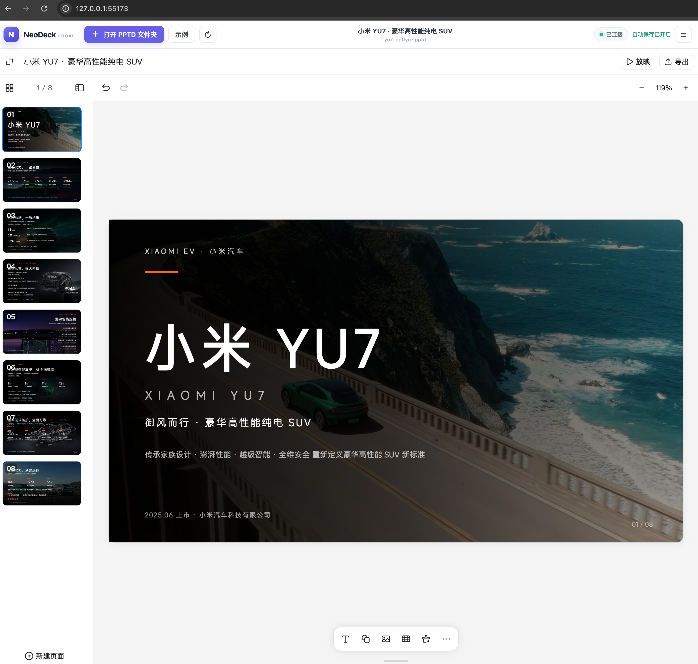](docs/images/example-yu7-editor.png) | [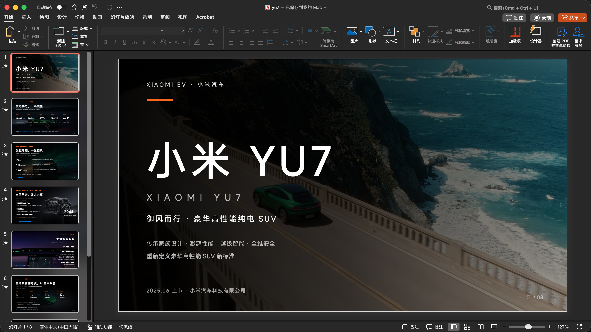](docs/images/example-yu7-pptx.png) |

[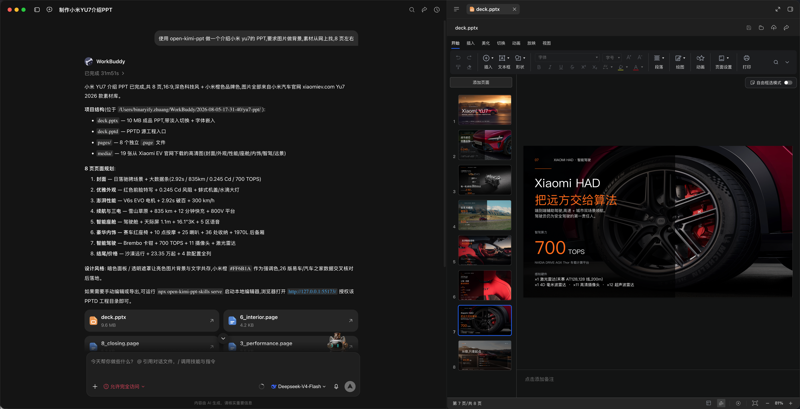](docs/images/example-workbuddy-yu7.png)

**示例 2：DJI Pocket 4（图片作背景）**

```text
使用 open-kimi-ppt 帮我生成DJI Pocket4 的 PPT,要求图片做背景,素材从网上找
```

| 在线编辑 PPTD | 导出 PPTX |
| :---: | :---: |
| [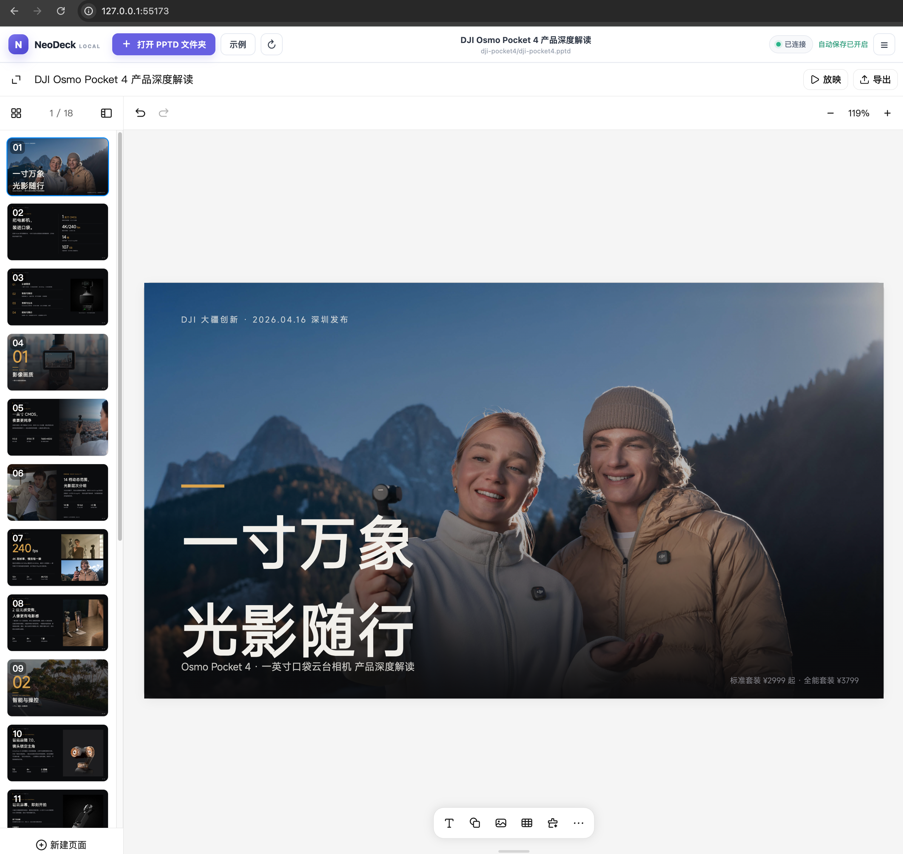](docs/images/example-dji-pocket4-editor.png) | [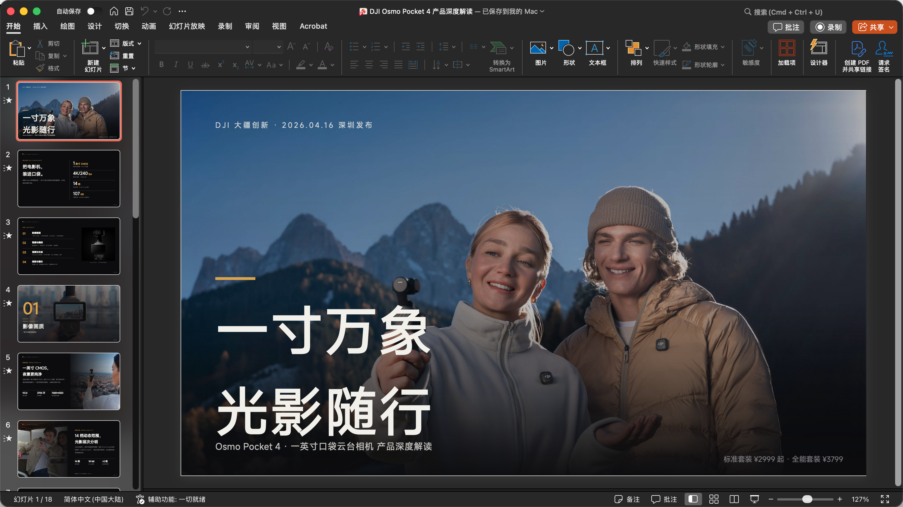](docs/images/example-dji-pocket4-pptx.png) |

**示例 3：iPhone 17 Pro（约 8 页）**

```text
使用 open-kimi-ppt 制作 iPhone 17 Pro 介绍 PPT
```

[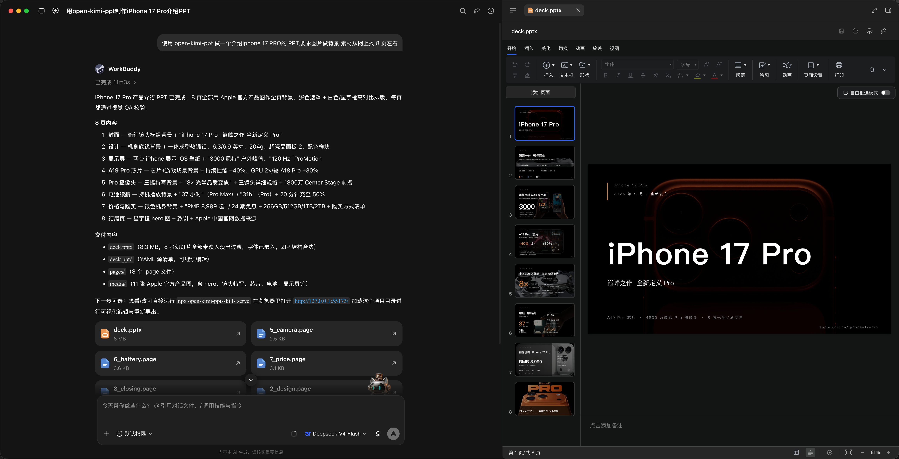](docs/images/example-iphone-17pro.png)

**示例 4：带页内元素动画（现场演示）**

```text
使用 open-kimi-ppt 做一个介绍小米 yu7的 PPT,要求图片做背景,素材从网上找,8 页左右
要求带元素入场动画
```

成品示例见 [example/xiaomi-yu7-ppt-animation](example/xiaomi-yu7-ppt-animation)（含 PPTD 项目与 PPTX，可用 `npx open-kimi-ppt-skills serve` 打开预览动画）。

### 在线编辑与手动导出

建议直接让 AI 启动本地编辑器，例如说：

```text
帮我执行 npx open-kimi-ppt-skills serve
```

也可以自己在终端运行：

```bash
npx open-kimi-ppt-skills serve
```

然后打开 <http://127.0.0.1:55173/>，选择包含 `.pptd` 清单、`pages/` 和 `media/` 的完整项目文件夹，即可在浏览器中查看、编辑项目并导出 PPTX。仓库自带的 [example/dji-pocket4](example/dji-pocket4) 是一个完整的 18 页示例项目，可直接打开体验。

```bash
# 启动后自动打开浏览器
npx open-kimi-ppt-skills serve --open

# 使用其他端口
npx open-kimi-ppt-skills serve --port 56000
```

可写目录需要使用支持 File System Access API 的 Chromium 系浏览器；其他浏览器会回退为只读文件夹上传。按 `Ctrl+C` 停止服务。

## 功能特性

> [!NOTE]
> **新版可编辑导出**：首次自动导出 PPTX 时会打开一个专用浏览器窗口，请在该窗口登录 Kimi。登录态仅保存在 `~/.open-kimi-ppt/browser-profile`，后续自动复用；不会接管日常浏览器，也不会把 Token 写入 PPTD、日志或仓库。新版会统计独立文本、形状、表格和图表对象，并默认拒绝把“每页一张图”的 PPTX 当作可编辑成品。

- **PPTD 生成**：让 Agent 生成完整、可继续编辑的 PPTD 项目，支持从零创作、风格迁移、模板复用、图片/PDF 复刻。
- **预设主题**：内置约 30 套官方同款 design system，点名即可套用；完整列表与预览图见 [theme.md](theme.md)。
- **元素动画**：默认不加。提示词加上「要求带元素入场动画」即可，由 AI 按页编排合适的入场效果。
- **PPTX 生成**：默认同步生成 PPTX 成品，自动嵌入字体并写入淡入淡出**翻页**切换（与页内元素动画是两回事）。
- **视觉质检**：多模态模型在导出 PPTX 前自动导出整份页面图片、拼接总览图逐项核查（变形、遮挡、出界、对比度、排版、文字溢出），问题页面修复后复检，直至全部通过。
- **在线编辑**：通过浏览器查看和编辑本地 PPTD 项目，自动保存，可配置页面切换动画。
- **手动导出**：在编辑器中随时手动导出 PPTX。
- **格式互转**：将现有 PPTX 转换为 PPTD 后继续修改。
- **安全可控**：本地编辑仅在用户明确授权的项目目录内读写文件。

## 为什么选 open-kimi-ppt

常见 PPT Skill 大致分三类：用代码库直接拼 OOXML / pptxgenjs、整页生成图片再塞进 PPTX、或输出网页 HTML 翻页。open-kimi-ppt 走的是 **PPTD 中间层 + 真实可编辑 PPTX** 路线，兼顾 Agent 好写、人好看、PowerPoint 能改。

| | open-kimi-ppt | 代码拼 PPTX（如 pptxgenjs） | 整页图片 PPT | 网页 HTML PPT |
| --- | --- | --- | --- | --- |
| 交付物 | PPTD 项目 + PPTX | 多为仅 PPTX | 多为仅 PPTX | 单文件 HTML |
| Agent 友好度 | YAML 逐页描述，结构清晰 | 坐标/API 细节多，易排版翻车 | 依赖出图模型与提示词 | HTML/CSS 模板约束强 |
| PowerPoint 可编辑 | 文本、形状、图片可继续改 | 可编辑，但难二次精修 | 整页位图，难改字 | 不是原生 PPTX |
| 视觉质量 | 真实版式 + 导出前多模态质检 | 依赖 Agent 手调布局 | 画面统一，偏海报感 | 动效强，适合演示分享 |
| 二次编辑 | 浏览器可视化编辑 + 自动保存 | 主要靠改代码重导出 | 基本需重新出图 | 改 HTML 源码 |
| 适用场景 | 要交可改的正式 PPTX，又要好看 | 结构化汇报、模板填充 | 视觉统一的海报风讲稿 | 浏览器内演讲 / 发布会 |

更具体地说，相对其他方案的优势是：

1. **中间格式为 Agent 设计**：PPTD 用 YAML 描述主题、布局与元素，比直接写 OOXML / pptxgenjs 更稳，也比「整页渲一张图」更可局部修改。
2. **默认同交两份成果**：可继续迭代的 PPTD 项目 + 开箱即用的 PPTX（嵌字体、淡入淡出翻页），不是只给半成品。
3. **支持元素动画**：提示词写「要求带元素入场动画」即可启用；具体效果与节奏由 AI 处理，无需用户点名动画类型。
4. **PPTX 真能改**：导出后文本框、形状仍可在 PowerPoint / WPS 里编辑，不像图片型 PPT 只能当海报。
5. **有本地可视化编辑器**：浏览器里预览、微调、配切换动画并手动再导出，不需要每次都让 Agent 重跑全流程。
6. **导出前强制视觉质检**：整页截图 + 总览图检查遮挡、出界、对比度、溢出等问题，修完再出 PPTX。
7. **不绑官方模型，成本更低**：相对官方 Kimi Slides，你可以在任意兼容 Agent 里使用 DeepSeek 等低成本模型；即便模型不支持多模态，只要按 PPTD 规范生成，也能做出不错的成品（有多模态时再做视觉质检会更稳）。

[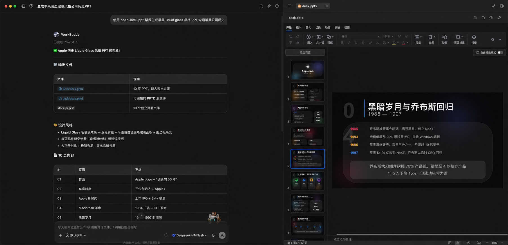](docs/images/example-deepseek-liquid-glass.png)

*上图：在 WorkBuddy 中使用 DeepSeek-V4-Flash 生成 Apple Liquid Glass 风格 PPT 的实际效果。*

[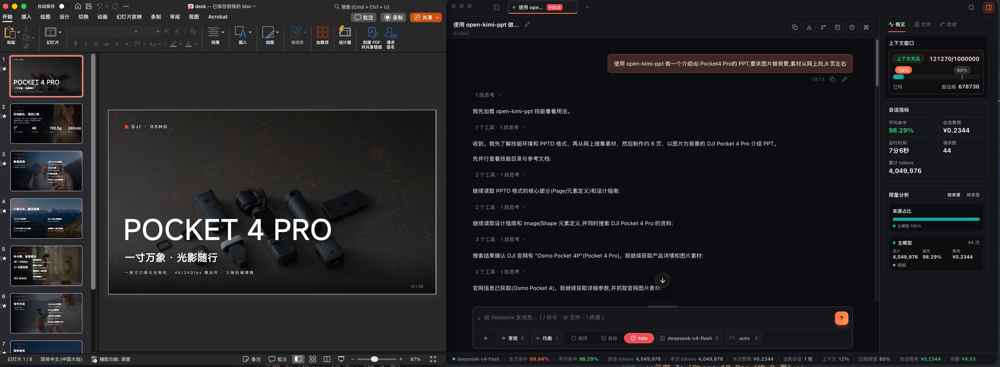](docs/images/example-reasonix-deepseek.png)

*上图：在 Reasonix 中使用 DeepSeek-V4-Flash 生成 DJI Pocket 4 Pro PPT。*

[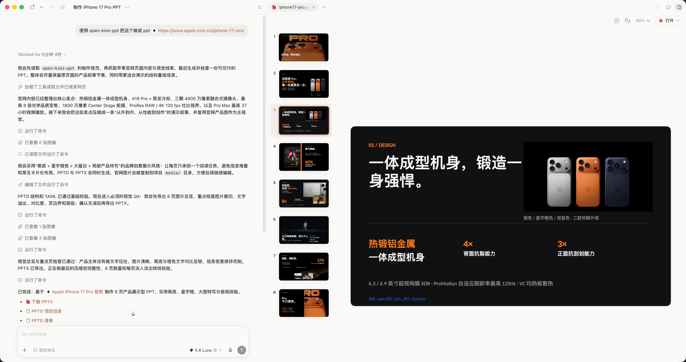](docs/images/example-codex-iphone17pro.png)

*上图：在 ChatGPT / Codex 中使用 5.6 Luna 模型生成 iPhone 17 Pro PPT，又快又好。*

### 关于风格与主题

默认 **不会** 自动套用固定主题：未指定风格时由 Agent 按场景指南自行发挥。Skill 内另附约 30 套官方同款 preset，**仅在你点名时**才会使用（例如「用 pine-green-strategy」）。

完整主题名、风格说明与预览图见 **[theme.md](theme.md)**。

> [!TIP]
> **强烈建议在 Prompt 里写明 PPT 风格、点名一套 preset，或直接附上参考 PPT / PPTX 模板。** 有风格约束或模板参照时，出品会明显更好、更稳定；只给主题不给风格时，Agent 会自行发挥，效果容易波动。

常见用法：

1. **在 Prompt 里描述风格**：例如「深色科技风」「杂志排版」「苹果 liquid glass」「极简留白 + 大字报」等；
2. **点名预设主题**：例如「用 `pine-green-strategy`」——主题列表见 [theme.md](theme.md)；
3. **提供参考模板**：上传现有 PPT / PPTX / 截图，让 Agent 迁移配色、版式与风格。

可组合使用：先点名 preset 或给模板定调，再用一句话补充本次要强化的风格。

## 界面预览

| 在线编辑 PPTD | 导出 PPTX |
| :---: | :---: |
| [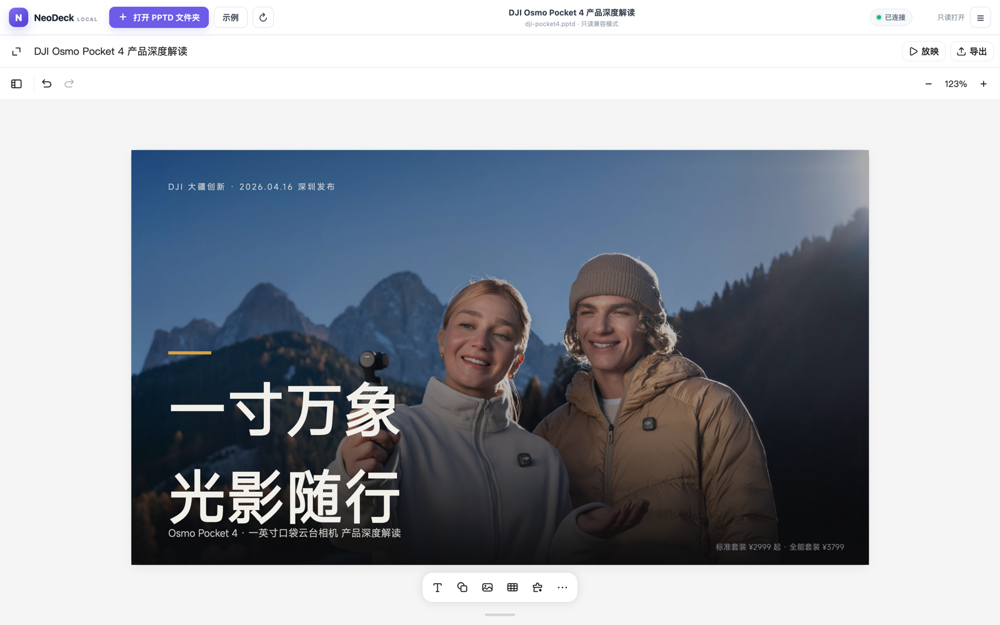](docs/images/editor-overview.png) | [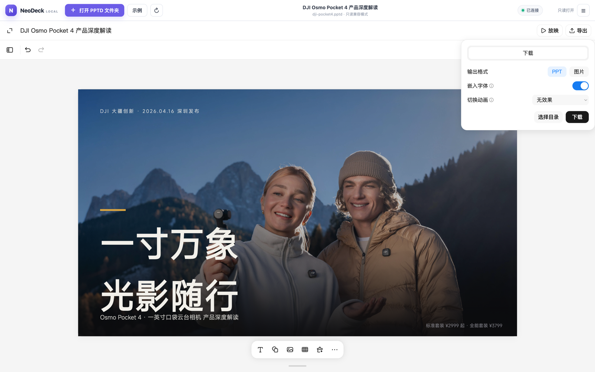](docs/images/export-pptx.png) |

## 什么是 PPTD

PPTD 是一种基于 YAML 的演示文稿 DSL，是 OOXML 之上的简化抽象层：保留主题、页面布局、元素位置等核心信息，去除了 Master 等复杂嵌套，每页自包含、所见即所得。完整的格式定义见 [reference/pptd.md](skills/open-kimi-ppt/reference/pptd.md)。

一个完整的 PPTD 项目目录结构如下：

```text
deck/
  deck.pptd     # 清单文件
  pages/        # 每页一个 .page 文件
  media/        # 本地媒体资源（如有）
  deck.pptx     # 默认同步生成的 PPTX 成品
```

## 工作原理与安全边界

- CLI 只在 `127.0.0.1` 启动静态文件服务，不会监听局域网地址。
- 浏览器只在用户主动授权后读取完整 PPTD 项目目录。
- 保存回调只允许修改 `.pptd` 和 `.page` 文件，并拒绝绝对路径与 `..` 路径越界。
- 自动导出使用独立 Chromium Profile，只在首次运行时要求登录 Kimi，不扫描或接管日常浏览器。
- 由于本地宿主中的 Kimi iframe 会受到 Chrome 第三方存储分区影响，导出器会在运行时从专用 Profile 读取当前 Token，并只注入该 iframe 分区。登录态及分区状态保存在该专用 Profile 中以便后续复用；Token 不打印、不写入 PPTD 或日志、不进入 Git。
- PPTD 内容由本地宿主交给公开的 Kimi 网页编辑器处理；远程图片、字体和编辑器资源仍可能从对应服务器加载。
- 自动导出完成后检查 ZIP、页数、转场及独立可编辑对象；默认拒绝只有整页图片的伪可编辑 PPTX。
- 若 `/apiv2/utils/v1/signatures` 返回 401，说明专用 Profile 登录已过期或分区认证未建立；重新运行并在可见浏览器中登录即可。

## 兼容性说明

这是针对当前公开实现的兼容宿主，不是稳定的官方 SDK。Kimi 更新前端资源哈希、PPTD 格式或 iframe/RPC 协议后，本项目可能需要同步升级。成功生成 PPTX 也不代表 PowerPoint、WPS 和 Keynote 对所有动画效果都能完全一致地播放。

## 本地开发

```bash
npm install --global .
npm test
npm run pack:check
```

## 声明

Kimi、Kimi Slides 及相关商标归其权利人所有。
