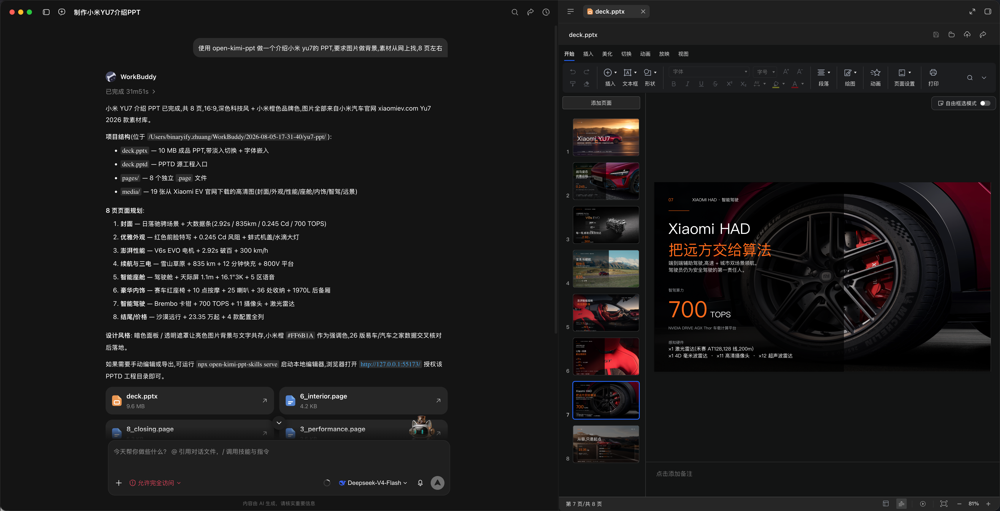
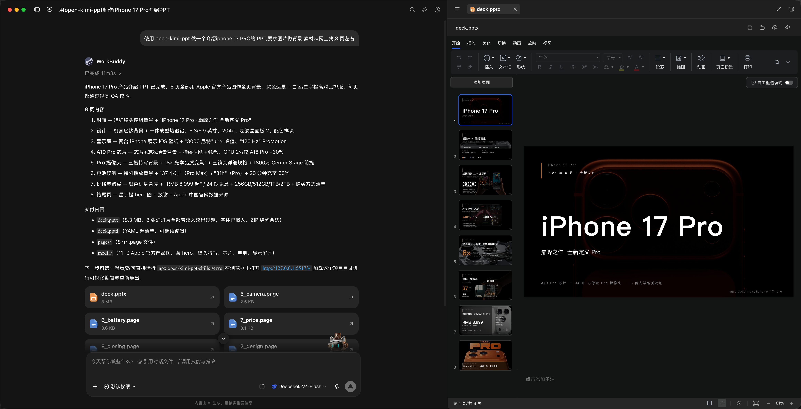
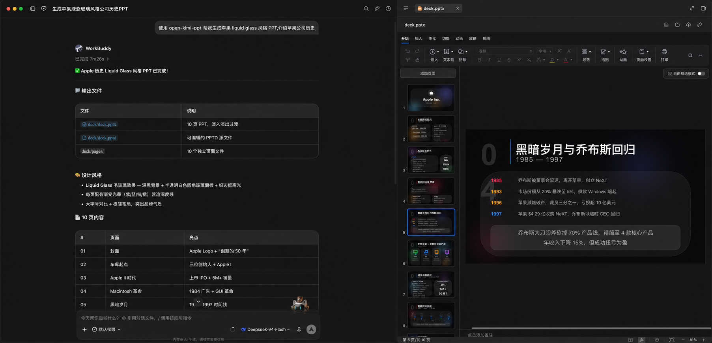
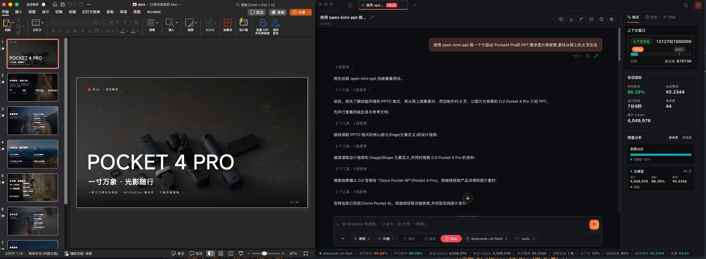
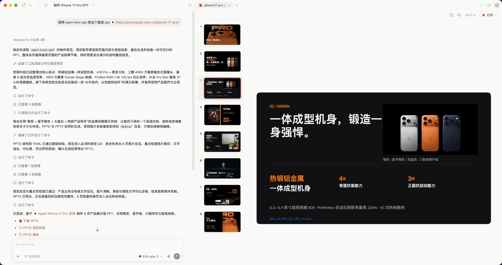
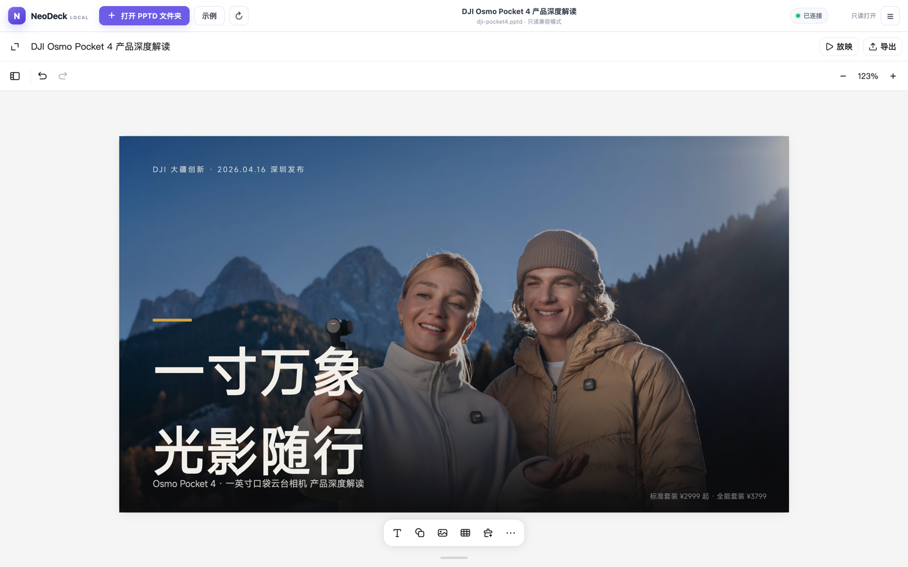
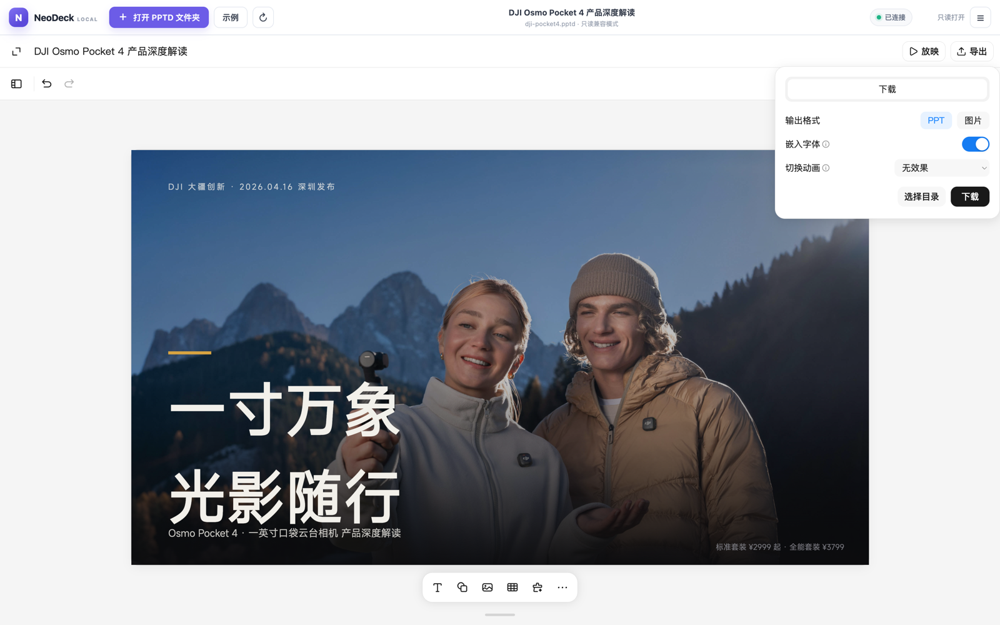

# open-kimi-ppt-skills

[简体中文](README.md) | [English](README_EN.md)

[](https://www.npmjs.com/package/open-kimi-ppt-skills)
[](https://nodejs.org)

An unofficial presentation skill for AI coding agents, reverse-engineered from Kimi Slides. It lets your agent create, edit, replicate, read, and export PPT/PPTX files. **Every run delivers two outputs by default: an editable PPTD project and a ready-to-use PPTX** — fonts embedded and fade page transitions included — with optional on-slide element animations and [preset themes](theme_EN.md), plus a local in-browser PPTD editor with manual PPTX export. Works with Codex, Claude Code, Cursor, WorkBuddy, and any agent that supports the SKILL.md format.

> [!IMPORTANT]
> This project is implemented by reverse-engineering the Kimi Slides skill, the PPTD format, and the frontend behavior and communication protocol of the publicly accessible web editor. It is not an official Kimi or Moonshot AI project and is not endorsed or supported by them. Public frontend resources and compatibility contracts used by this project may change without notice. Provided for learning and research purposes only.

## Upstream And This Release

This repository continues the MIT-licensed work from [pressdot/open-kimi-ppt-skill](https://github.com/pressdot/open-kimi-ppt-skill), with the original license and author attribution retained. This release focuses on hardened editable PPTX export, Kimi third-party iframe authentication partition handling, Playwright download capture, visual QA, atomic output replacement, editable-object validation, cross-platform path protection, and pre-release sensitive-data scanning. Current maintenance and issue tracking live at [Angel-Gril/Kimi-PPT-Skills](https://github.com/Angel-Gril/Kimi-PPT-Skills).

Neither the repository nor the npm package contains user browser profiles, login tokens, API keys, business presentations, or local debug logs. The dedicated browser profile created on first export stays only on the user's machine, outside the repository.

## Install

Node.js 18 or later is required.

**Pick one method — do not run both**, or you may end up with duplicate installs across directories. By default the skill lands in the shared directory `~/.agents/skills/open-kimi-ppt` (Windows: `%USERPROFILE%\.agents\skills\open-kimi-ppt`). For most agents that discover that path, a single install is enough.

### Option 1: Automatic install (recommended)

Ask your agent with either of these prompts and let it install for you:

```text
Install the open-kimi-ppt skills from GitHub for me.
```

```text
Install https://github.com/Angel-Gril/Kimi-PPT-Skills for me.
```

After that, you usually do **not** need to run `npx ... install` yourself.

### Option 2: Manual install

Run this in your terminal:

```bash
npx open-kimi-ppt-skills install
```

Only add `--target` if your agent **does not** pick up `~/.agents/skills` and must use its own skills directory (paths below are for macOS / Linux; on Windows replace `~` with `%USERPROFILE%`, e.g. `%USERPROFILE%\.codex\skills`):

```bash
# Codex
npx open-kimi-ppt-skills install --target ~/.codex/skills

# Claude Code
npx open-kimi-ppt-skills install --target ~/.claude/skills

# Cursor
npx open-kimi-ppt-skills install --target ~/.cursor/skills

# WorkBuddy
npx open-kimi-ppt-skills install --target ~/.workbuddy/skills
```

> Do not install once per agent by default. Start with the shared directory; only use `--target` for an agent that cannot discover the skill there.

### Update

When the skill is updated, run install again — it overwrites the local installation:

```bash
npx open-kimi-ppt-skills@latest install
```

If you originally installed with `--target`, pass the same path again:

```bash
npx open-kimi-ppt-skills@latest install --target ~/.claude/skills
```

You can also ask your agent: `Update the open-kimi-ppt skill for me.` Updating only replaces the skill files; it does not touch PPTD / PPTX projects you already generated.

## Usage

### Generate a presentation with your agent

Once installed, just describe what you need. **You always get two deliverables by default**: the complete, editable PPTD project directory and the matching PPTX file. PPTX generation is skipped only when you explicitly ask for PPTD-only output.

For more stable quality, put a style in the prompt (e.g. “dark product-launch look”) or attach a reference PPT template; topic-only prompts without style guidance tend to vary more.

```text
Use open-kimi-ppt to create a liquid-glass-style deck about the history of Apple.
```

**Example: Xiaomi YU7 (~8 pages, images as backgrounds)**

```text
Use open-kimi-ppt to create a Xiaomi YU7 intro PPT, with images as backgrounds from the web, about 8 pages.
```

[](docs/images/example-workbuddy-yu7.png)

**Example: iPhone 17 Pro (~8 pages)**

```text
Use open-kimi-ppt to create an iPhone 17 Pro intro PPT.
```

[](docs/images/example-iphone-17pro.png)

**Example: on-slide element animations (live presentation)**

```text
Use open-kimi-ppt to create a Xiaomi YU7 intro PPT, with images as backgrounds from the web, about 8 pages.
Require element entrance animations.
```

See the sample deck at [example/xiaomi-yu7-ppt-animation](example/xiaomi-yu7-ppt-animation) (PPTD project + PPTX; open with `npx open-kimi-ppt-skills serve` to preview animations).

### Edit online and export manually

Prefer asking your agent to start the local editor, for example:

```text
Run npx open-kimi-ppt-skills serve for me.
```

Or run it yourself in a terminal:

```bash
npx open-kimi-ppt-skills serve
```

Then open <http://127.0.0.1:55173/> and choose a complete project folder containing the `.pptd` manifest, `pages/`, and `media/` to view, edit, and export PPTX in the browser. The bundled [example/dji-pocket4](example/dji-pocket4) project — a complete 18-page deck — is ready to open for a quick tour.

```bash
# Open the browser after startup
npx open-kimi-ppt-skills serve --open

# Use another port
npx open-kimi-ppt-skills serve --port 56000
```

Writable folder access requires a Chromium-based browser with the File System Access API. Other browsers fall back to read-only folder upload. Press `Ctrl+C` to stop the server.

## Features

> [!NOTE]
> **Hardened editable export**: the first automatic PPTX export opens a dedicated browser window and asks you to sign in to Kimi there. The login is stored only in `~/.open-kimi-ppt/browser-profile` and reused later; the exporter never takes over your everyday browser and never writes tokens to PPTD, logs, or the repository. The exported deck is checked for independent text, shapes, tables, and charts, and image-only PPTX files are rejected by default.

- **PPTD generation**: let your agent generate complete, editable PPTD projects — from scratch, with style transfer, template reuse, or replication from images/PDFs.
- **Preset themes**: ~30 official-style design systems you can name to apply; full list with previews in [theme_EN.md](theme_EN.md).
- **Element animations**: Off by default. Add `Require element entrance animations` to the prompt; the agent picks suitable on-slide effects per page.
- **PPTX generation**: produce a matching PPTX by default, with fonts embedded and fade **page** transitions written automatically (separate from on-slide element animations).
- **Visual QA**: with a multimodal model, the skill exports every page as an image, stitches them into an overview sheet, and checks each page (distortion, occlusion, out-of-bounds elements, contrast, layout consistency, text overflow) before PPTX export — fixing and re-checking until every page passes.
- **Online editing**: view and edit local PPTD projects in a browser, with autosave and configurable slide transitions.
- **Manual export**: export PPTX manually from the editor at any time.
- **Format conversion**: convert existing PPTX files to PPTD for further editing.
- **Secure by design**: local editing only reads and writes project directories explicitly authorized by the user.

## Why open-kimi-ppt

Most PPT skills fall into three buckets: assemble OOXML / pptxgenjs in code, render each slide as a full-bleed image, or ship a swipeable HTML deck. open-kimi-ppt takes a **PPTD intermediate layer + real editable PPTX** path — easy for agents to write, good to look at, and still editable in PowerPoint.

| | open-kimi-ppt | Code-built PPTX (e.g. pptxgenjs) | Full-slide image PPT | Web HTML PPT |
| --- | --- | --- | --- | --- |
| Deliverable | PPTD project + PPTX | Usually PPTX only | Usually PPTX only | Single HTML file |
| Agent-friendly | Clear per-page YAML | Lots of coordinates/API detail | Depends on image models & prompts | Strong HTML/CSS template constraints |
| Editable in PowerPoint | Text, shapes, images stay editable | Editable, but hard to refine later | Flat bitmaps — hard to reword | Not native PPTX |
| Visual quality | Real layouts + multimodal QA before export | Relies on agent layout tuning | Cohesive, poster-like | Strong motion; great for live demos |
| Re-editing | Browser visual editor + autosave | Mostly re-run code | Usually regenerate images | Edit HTML source |
| Best for | Formal PPTX you still need to tweak | Structured reports / template fills | Visually unified poster decks | In-browser talks / launches |

In short:

1. **DSL built for agents** — PPTD describes theme, layout, and elements in YAML, more stable than raw OOXML / pptxgenjs, and more locally editable than full-slide images.
2. **Two deliverables by default** — an iterable PPTD project plus a ready-to-open PPTX (embedded fonts, fade page transitions).
3. **Element animations** — add `Require element entrance animations` to the prompt; the agent chooses effects and timing for you.
4. **Truly editable PPTX** — text boxes and shapes remain editable in PowerPoint / WPS, unlike image-only decks.
5. **Local visual editor** — preview, tweak, set transitions, and re-export in the browser without rerunning the whole agent flow.
6. **Visual QA before export** — full-page screenshots plus an overview sheet catch occlusion, overflow, contrast, and layout issues before PPTX is written.
7. **Not locked to the official model — lower cost** — unlike official Kimi Slides, you can run this in any compatible agent with cheaper models such as DeepSeek. Even without multimodal vision, a model that follows the PPTD spec can still produce strong decks (multimodal helps more with the visual QA pass).

[](docs/images/example-deepseek-liquid-glass.png)

*Above: an Apple Liquid Glass-style deck generated with DeepSeek-V4-Flash in WorkBuddy.*

[](docs/images/example-reasonix-deepseek.png)

*Above: a DJI Pocket 4 Pro deck generated with DeepSeek-V4-Flash in Reasonix.*

[](docs/images/example-codex-iphone17pro.png)

*Above: an iPhone 17 Pro deck generated with the 5.6 Luna model in ChatGPT / Codex — fast and strong.*

### Style and themes

By default the agent **does not** auto-apply a fixed theme: without a style cue it follows the scenario guides. The skill also ships ~30 official-style presets, used **only when you name one** (e.g. “use pine-green-strategy”).

Browse theme IDs, descriptions, and preview images in **[theme_EN.md](theme_EN.md)**.

> [!TIP]
> **Best results come from stating a PPT style in the prompt, naming a preset, or attaching a reference PPT / PPTX template.** With a style constraint or template to follow, output quality is clearly better and more stable. Topic-only prompts leave the agent free to invent a look, so results vary more.

Common approaches:

1. **Describe the style in the prompt** — e.g. dark tech, magazine layout, Apple liquid glass, minimal big-type poster slides;
2. **Name a preset theme** — e.g. “use `pine-green-strategy`”; see the catalog in [theme_EN.md](theme_EN.md);
3. **Provide a reference template** — upload an existing PPT / PPTX / screenshot and ask the agent to transfer colors, layout, and overall style.

You can combine these: lock the look with a preset or template, then add one line about the style you want to emphasize.

## Screenshots

| Edit PPTD online | Export PPTX |
| :---: | :---: |
| [](docs/images/editor-overview.png) | [](docs/images/export-pptx.png) |

## What is PPTD

PPTD is a YAML-based presentation DSL — a simplified abstraction layer over OOXML. It preserves the essentials (theme, page layout, element positions) while dropping complex nesting such as Masters; every page is self-contained — what you see is what you get. See [reference/pptd.md](skills/open-kimi-ppt/reference/pptd.md) for the complete definition.

A complete PPTD project looks like this:

```text
deck/
  deck.pptd     # manifest
  pages/        # one .page file per slide
  media/        # local media assets (if any)
  deck.pptx     # PPTX generated by default
```

## How it works and security boundaries

- The CLI serves static files on `127.0.0.1` only and does not listen on LAN interfaces.
- The browser reads a complete PPTD project directory only after explicit user authorization.
- Save callbacks may only modify `.pptd` and `.page` files; absolute paths and `..` traversal are rejected.
- Automatic export uses a dedicated Chromium profile, asks for Kimi sign-in only on the first run, and never scans or attaches to an everyday browser profile.
- Because the Kimi iframe under the localhost host is affected by Chrome third-party storage partitioning, the exporter reads the current tokens from the dedicated profile at runtime and injects them only into that iframe partition. The login and partition state remain in that dedicated profile for later reuse; tokens are never printed, written into PPTD or logs, or committed to Git.
- PPTD content is passed from the local host to the public Kimi web editor; remote images, fonts, and editor resources may still be fetched from their respective servers.
- Automatic export validates ZIP structure, slide count, transitions, and independent editable objects; an image-per-slide fallback is rejected by default.
- HTTP 401 from `/apiv2/utils/v1/signatures` means the dedicated-profile login expired or partitioned authentication was not initialized; rerun in headed mode and sign in when prompted.

## Optional host-side export without sign-in

The default exporter uses Kimi's writer and requires sign-in. An optional host
channel can download a pre-rendered PPTX without reading or saving login state:

```bash
# Limited reference renderer: text, solid backgrounds and fade transitions
python skills/open-kimi-ppt/scripts/export_pptx_host.py \
  --project example/dji-pocket4 --auto-generate -o out.pptx

# Use a PPTX produced by your own generator
python skills/open-kimi-ppt/scripts/export_pptx_host.py \
  --project example/dji-pocket4 --pptx my-render.pptx -o out.pptx

# Generate the reference file directly, without loading the browser editor
python skills/open-kimi-ppt/scripts/pptd_to_pptx.py example/dji-pocket4/dji-pocket4.pptd out.pptx
```

The host page opts in with `?hostExport=1` and sets `sdkExportMode=external`.
`--auto-generate` renders live: every editor autosave hands the host the current
virtual file system (`fileContent`), and the export re-renders that latest content,
so edits made in the browser reach the download. `--pptx` replays a fixed artifact
instead, where later edits are ignored and the host says so. File bytes are passed
through host RPC without granting the remote page local-network access. The browser
channel still
requires network access to Kimi and may make anonymous account requests; it does
not use authenticated export signatures or a persistent browser profile.

Both entry points check project paths and preserve existing outputs unless
`--force` is supplied. Supplied PPTX files must have a valid package structure
and the same page count as the project. Downloads are checked against the host
artifact and validated before the destination is committed.

> [!WARNING]
> Output quality depends on your generator. The bundled reference renderer
> preserves text, geometry, font sizes, theme colors, solid backgrounds and fade
> transitions. Mixed rich-text styling is simplified; images, shapes, charts,
> element animations and font embedding are omitted. Package integrity checks
> do not establish official rendering quality or editability. Use the default
> `export_pptx.py` for the official writer.

## Compatibility

This is a compatibility host for the current public implementation, not a stable official SDK. Updates to Kimi frontend asset hashes, the PPTD format, or the iframe/RPC protocol may require a corresponding project update. Successfully generating a PPTX does not guarantee identical animation playback in PowerPoint, WPS, and Keynote.

## Local development

```bash
npm install --global .
npm test
npm run pack:check
```

## Legal

Kimi, Kimi Slides, and related trademarks belong to their respective owners.
